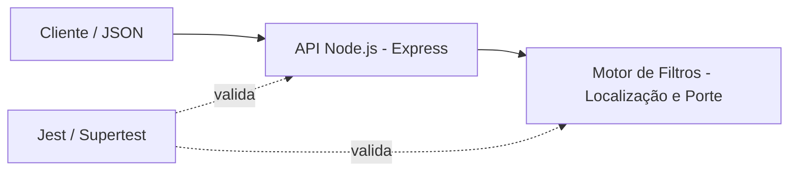
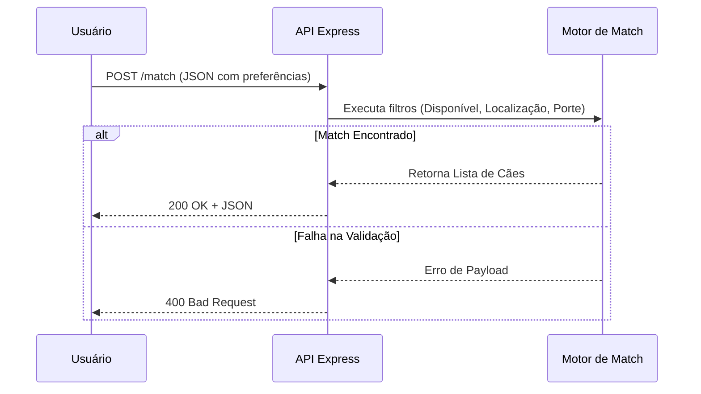

# # 🐶 Dog Match API

Uma API RESTful desenvolvida para cruzar o perfil de humanos com características de cachorros disponíveis para adoção, aumentando a taxa de sucesso e diminuindo devoluções nos abrigos.

## 🛠 Tecnologias e Metodologia
- **Linguagem/Framework:** Node.js com Express
- **Testes:** Jest e Supertest (Test Harness)
- **Infraestrutura:** Docker e Docker Compose
- **Metodologia:** Spec-Driven Development (SDD)

## 🤖 Orquestração de Inteligência Artificial
Este projeto utilizou IA de forma orquestrada e governada. Utilizamos o editor **Cursor** guiado estritamente pelas instruções do arquivo `.cursorrules`. Isso garantiu que a IA respeitasse a nossa arquitetura SDD, gerando os endpoints e a lógica de negócios sem desviar dos contratos definidos no `SPECIFICATION.md`.

## 🚀 Como rodar o projeto localmente (Guia de Execução)

O projeto está totalmente empacotado utilizando contentores. Certifique-se de ter o Docker e o Docker Compose instalados.

**1. Configuração de Variáveis de Ambiente:**
A aplicação utiliza a porta 8080 por defeito. Se necessitar, pode criar um ficheiro `.env` na raiz do projeto:
`PORT=8080`

**2. Subir a aplicação (Ambiente Padronizado):**
Na raiz do projeto, execute o comando único para construir e iniciar o contentor em segundo plano:
`docker-compose up -d --build`

A API estará disponível em: `http://localhost:8080/match`

**3. Executar o Test Harness e Relatório de Cobertura:**
Com o contentor a correr, pode acionar a suite de testes aprovada e verificar a cobertura de código executando:
`docker-compose exec api npm run test:coverage`

**4. Derrubar os contentores:**
Para parar e remover os contentores, utilize:
`docker-compose down`

## 📄 Contrato da API
O sistema expõe um endpoint `POST /match` que recebe o perfil do usuário e devolve os cães compatíveis. Consulte o arquivo `SPECIFICATION.md` na raiz do repositório para ver as regras de negócio detalhadas e os payloads de entrada/saída.

## 🏗️ Arquitetura da Solução e Defesa do Projeto (ADRs)

Para garantir a escalabilidade, padronização e qualidade do código gerado, a equipa tomou as seguintes Decisões de Arquitetura (Architecture Decision Records - ADRs):

* **ADR 01: Adoção de Node.js com Express**
  * **Contexto:** Precisávamos de uma API RESTful leve e rápida para processar o algoritmo de *match* entre humanos e cães.
  * **Decisão:** Optámos pelo ecossistema Node.js devido à sua natureza assíncrona, facilidade de manipulação de JSON (nativo no JavaScript) e vasta documentação.
* **ADR 02: Testes Automatizados com Jest e Supertest**
  * **Contexto:** A orquestração por IA tem tendência a gerar regressões ou ignorar regras de negócio.
  * **Decisão:** Implementámos uma *suite* de testes *end-to-end* (Test Harness) para bater diretamente no *endpoint* da API, garantindo que as regras do `SPECIFICATION.md` são validadas a cada *commit*.
* **ADR 03: Governança de IA via Spec-Driven Development (SDD)**
  * **Contexto:** Ferramentas de IA generativa (como o Cursor) podem sofrer "alucinações" ou divergir da arquitetura base.
  * **Decisão:** Restringimos a autonomia da IA utilizando um ficheiro `.cursorrules`. A IA foi forçada a ler os contratos antes de gerar o código, transformando-a numa assistente de codificação estritamente controlada pela equipa humana (revisores).

  ## Arquitetura e Fluxo da Aplicação (Mermaid)

## 🤝 Relato de Experiência e Comunicação Técnica

O desenvolvimento deste MVP em grupo foi um excelente exercício de colaboração e governança. O maior desafio inicial foi manter a consistência do código gerado por IA entre diferentes membros da equipa. 

Através da adoção do **Git Flow** (Feature Branches e Pull Requests rigorosos), conseguimos intercetar erros lógicos (como o *endpoint* com verbo HTTP incorreto) e alucinações de *stack* tecnológica (código gerado em Python em vez de Node.js) durante a fase de *Code Review*. O papel da revisão humana provou ser indispensável para garantir a integridade da arquitetura final.
